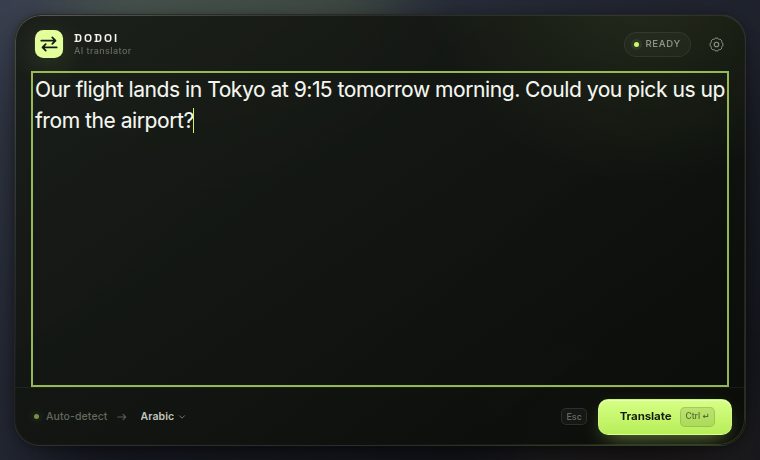
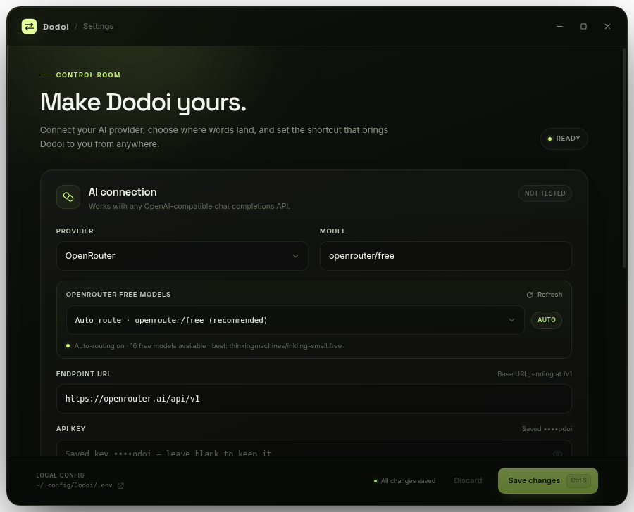

# Dodoi

Dodoi is a floating AI translator that lives above every app. Press a global shortcut, type or paste text, hit **Ctrl + Enter**, and the translation is copied and inserted into the app you were using.

Built with Electron, vanilla JavaScript, HTML/CSS, and Tailwind CSS. Works with any OpenAI-compatible chat completions API, or fully offline with the built-in NLLB-200 engine.

## Preview





The standalone landing page lives in [`landing/`](landing/) — a self-contained static page that mirrors the app's dark, glassy visual language.

## Features

- Frameless, transparent glassmorphism overlay that follows the cursor's display
- Summon from anywhere with a configurable global shortcut (**Shift + ~** by default)
- Translation-only system prompt with tone, dialect, and formatting preservation
- Automatic clipboard copy and paste-back into the previously focused app
- Provider presets for OpenAI, OpenRouter, and Groq, plus any custom compatible endpoint
- Fully offline NLLB-200 3.3B provider using CTranslate2 INT8
- One-click model download and conversion with live progress, resumable downloads, and disk/RAM checks
- On-demand local engine with a localhost-only, token-protected server and a real **Stop** that releases RAM
- Optional launch at startup in the system tray, with local-engine warm-up when the local provider is selected
- Smart Fallback to the last saved cloud connection when the local engine is stopped or fails
- OpenRouter free-model support: stable `openrouter/free` auto-routing plus a live free-model picker
- Automatic retry through `openrouter/free` when a selected free model is retired or unavailable
- Connection testing against the provider's `/models` endpoint
- Configurable target language, model, endpoint, and API key
- API key masked in the UI and stored only in a local `.env` file
- Tray menu and ready-to-ship installers for Windows, macOS, and Linux
- Windows NSIS wizard with a custom install directory and selectable desktop/Start Menu shortcuts, macOS DMG with drag-to-Applications, Linux AppImage plus Debian package
- Optional embedded NLLB model for offline-first installers, with the normal first-run download as a fallback

## Requirements

- Node.js 20.19 or newer (22.12+ or 24 LTS recommended) and npm
- Cloud translation: an OpenAI-compatible API key and endpoint
- Offline translation: Python 3.10–3.13 (3.12 or 3.13 recommended), about 24 GB of free disk space for the first-time download and conversion, and 16 GB of RAM recommended (8 GB can fail during 3.3B conversion)
- Internet access once if you want to download the offline model

## Install

Download the latest installer for your platform from your release channel. The CI workflow in `.github/workflows/build.yml` produces these artifacts:

| Platform | Artifact | Installation |
| --- | --- | --- |
| Windows 10/11 x64 | `Dodoi-Setup-0.1.0-x64.exe` | Run the NSIS wizard, choose an install directory, and select the desktop and Start Menu shortcuts you want. |
| macOS 12+ | `Dodoi-0.1.0-x64.dmg` or `Dodoi-0.1.0-arm64.dmg` | Open the DMG, drag **Dodoi** to **Applications**, then launch it. You can move the app to another folder afterwards. |
| Linux x64 | `Dodoi-0.1.0-x86_64.AppImage` | `chmod +x Dodoi-0.1.0-x86_64.AppImage`, then run it. No installation is required. |
| Ubuntu/Debian x64 | `Dodoi-0.1.0-amd64.deb` | `sudo apt install ./Dodoi-0.1.0-amd64.deb` |

Release builds are signed and notarized when the repository has the matching certificates and Apple credentials configured; otherwise the CI workflow still uploads usable unsigned artifacts. On macOS, an unsigned local build may require right-clicking the app and choosing **Open** the first time. On Linux, if FUSE 2 is unavailable, run the AppImage with `APPIMAGE_EXTRACT_AND_RUN=1`.

Windows uninstall removes Dodoi's app data and its launch-at-startup registry values. macOS and Linux uninstallers leave user data in place; remove `~/Library/Application Support/Dodoi` or `~/.config/Dodoi` by hand if you also want to delete settings, the Python environment, and any downloaded model. If **Launch on startup** was enabled on Linux, also remove `$XDG_CONFIG_HOME/autostart/dodoi.desktop` (normally `~/.config/autostart/dodoi.desktop`).

### Build from source

```bash
npm install
cp .env.example .env
```

On Windows PowerShell:

```powershell
npm install
Copy-Item .env.example .env
```

Start the app in development mode:

```bash
npm run dev
```

Or build the renderer and run the production bundle:

```bash
npm start
```

To configure everything without touching the file, open **Settings** from the tray menu, the overlay's gear button, or the target-language chip.

## Usage

| Action | Shortcut |
| --- | --- |
| Show or hide Dodoi | **Shift + ~** (configurable) |
| Translate | **Ctrl + Enter** (macOS: **Cmd + Enter**) |
| Dismiss the overlay | **Esc** |
| Save settings | **Ctrl + S** (macOS: **Cmd + S**) |

1. Focus any app and press the global shortcut.
2. Type or paste the text you want to translate.
3. Press **Ctrl/Cmd + Enter**. The input locks while the request is in flight.
4. Dodoi copies the result, hides, and pastes it into your previous app.

If Dodoi cannot focus the previous app, the translation stays on your clipboard and a desktop notification tells you to paste manually.

## Configuration

Dodoi reads its settings from `.env`. During development this is the project root. In a packaged app it is stored in Electron's `userData` directory, and the path is shown at the bottom of Settings.

| Key | Default | Description |
| --- | --- | --- |
| `DODOI_PROVIDER` | `openai` | Provider preset name (`openai`, `openrouter`, `groq`, `local-nllb`, `custom`) |
| `DODOI_API_KEY` | empty | API key for the cloud provider |
| `DODOI_API_URL` | `https://api.openai.com/v1` | Base URL of the OpenAI-compatible API; also the cloud snapshot used by Smart Fallback |
| `DODOI_MODEL` | `gpt-4o-mini` | Cloud chat model ID |
| `DODOI_TARGET_LANGUAGE` | `English` | Language every translation is written in |
| `DODOI_SHORTCUT` | ``Shift+` `` | Electron accelerator for the global shortcut |
| `DODOI_LAUNCH_AT_STARTUP` | `false` | Start Dodoi hidden in the system tray when you sign in |
| `DODOI_SMART_FALLBACK` | `true` | Use the saved cloud connection if the local engine is stopped or fails |
| `DODOI_FALLBACK_PROVIDER` | `openai` | Last saved cloud provider snapshot |
| `DODOI_FALLBACK_API_URL` | `https://api.openai.com/v1` | Last saved cloud endpoint snapshot |
| `DODOI_FALLBACK_MODEL` | `gpt-4o-mini` | Last saved cloud model snapshot |

Values are quoted and escaped automatically when saved from Settings. Unrelated variables in the file are preserved. The fallback snapshot is updated automatically whenever a cloud provider is saved, so you only need to configure one cloud connection.

The endpoint can be either a base URL (`https://api.example.com/v1`) or a full chat completions URL (`https://api.example.com/v1/chat/completions`). Dodoi derives both the chat and `/models` URLs from it.

## Launch on startup

Turn on **Settings → Global shortcut → Launch on startup** to keep Dodoi waiting in the system tray after you sign in. Dodoi starts hidden, registers the global shortcut immediately, and stays out of the way until you press it.

- Windows and macOS use the system login-item mechanism.
- Linux writes `~/.config/autostart/dodoi.desktop` (or the equivalent for your `XDG_CONFIG_HOME`). AppImage builds point the entry at the real `.AppImage` file, not the temporary mount.
- If the local NLLB provider is selected and the model is already installed, Dodoi warms the local engine in the background at sign-in. If it is not installed or fails to start, Smart Fallback still handles translations through the saved cloud connection.
- Turning the toggle off and saving removes the startup registration immediately.

You can override the config location with `DODOI_ENV_FILE`:

```bash
DODOI_ENV_FILE=/path/to/.env npm start
```

## Provider examples

| Provider | Endpoint | Example model |
| --- | --- | --- |
| OpenAI | `https://api.openai.com/v1` | `gpt-4o-mini` |
| OpenRouter | `https://openrouter.ai/api/v1` | `openrouter/free` |
| Groq | `https://api.groq.com/openai/v1` | `llama-3.3-70b-versatile` |
| Ollama | `http://localhost:11434/v1` | `llama3.2` |
| LM Studio | `http://localhost:1234/v1` | any loaded model |

A local server still requires an API key value in Dodoi; most local servers accept any non-empty string.

The built-in **Local · NLLB-200 (offline)** provider is not an OpenAI-compatible endpoint. Select it from the provider menu; it does not use an endpoint URL, model ID, or API key.

## OpenRouter free models

OpenRouter changes its free-model lineup often. Dodoi handles that in two layers:

1. **Stable auto-routing.** Use `openrouter/free` as the model. OpenRouter routes each request to a free, compatible model that is available at that moment. This setting never needs to be updated when individual models are retired.
2. **Live free-model discovery.** When OpenRouter is selected, Settings automatically fetches the public `GET https://openrouter.ai/api/v1/models` endpoint. Models tagged with `:free`, or with both prompt and completion pricing set to `0`, appear in the free-model picker. The list is ranked by explicit free availability, context size, and recency, with the best option marked in the picker.

If you choose a specific free model and it is later removed, rate-limited, or unavailable, Dodoi retries the translation through `openrouter/free` without interrupting the flow. After a successful fallback, the router is saved as the model in `.env` so the failure does not repeat. Auto-routing remains available even if the free-model list cannot be fetched.

## Local NLLB-200 (offline)

Choose **Local · NLLB-200 (offline)** from the provider menu when you want translation to stay on your device. Installers may include the converted INT8 model; when they do, Settings shows **Bundled · INT8** and no model download is needed. Builds without the bundled model need an internet connection for the first-time fetch. After the model is present, translation works offline.

### First-time setup for download builds

1. Install Python 3.10–3.13 and make sure `python3 --version` works. On Linux, install `python3-venv` if your distribution separates it.
2. Open **Settings → Provider → Local · NLLB-200 (offline)**.
3. Press **Download & Convert**. Dodoi creates an isolated virtual environment, downloads the 17.6 GB PyTorch source model from Hugging Face, converts it to a 3.5 GB CTranslate2 INT8 model, and removes the source weights after a successful conversion. Interrupted downloads resume where they stopped.
4. Press **Start engine**. The first load can take a minute while the INT8 weights move into RAM.

The Settings panel shows the current stage, byte progress, Python version, model size, available memory, and disk-space warnings. A low-memory machine can still download the model, but 3.3B conversion is likely to fail below 16 GB of RAM.

### Bundled model builds

Dodoi can embed the converted model in the installer. Release builders stage the model under `local-models/nllb-200-3.3B-int8/` before packaging; `npm run verify:model` checks that the directory looks complete. When present, the model is copied to `resources/local-engine/models/` and the app prefers it over any copy in `userData`.

A bundled build still creates its Python virtual environment and installs the ML packages on the first **Start engine** (or when a background autostart warm-up needs them). That keeps the installer small enough for the Electron portion to stay ordinary while the multi-gigabyte model ships as read-only application data.

### Storage and lifecycle

The Python runtime and logs live under Electron's `userData` directory. A downloaded model is stored there too; a bundled model stays read-only inside the installed app.

```text
userData/local-engine/
  venv/                         Isolated Python runtime and ML packages
  models/
    nllb-200-3.3B-source/       Temporary source weights (removed after conversion)
    nllb-200-3.3B-int8/         Converted model from Download & Convert
  engine.log                    Runtime, download, and conversion log

<install directory>/resources/local-engine/models/
  nllb-200-3.3B-int8/           Read-only model shipped by a bundled installer
```

In normal use the engine starts only when you press **Start engine**, and **Stop engine** kills the Python process so its RAM is released. When **Launch on startup** is enabled, a system sign-in launch also warms the engine if the local provider is selected and the model is installed (bundled or downloaded). Quitting Dodoi kills it synchronously. Saving a cloud provider while the local engine is online stops the engine.

The local server binds only to `127.0.0.1` on an ephemeral port and requires a random bearer token generated for each run. The token is passed to the Python process through its environment and is never exposed to the renderer.

### Languages

NLLB-200 uses FLORES-200 codes. Dodoi maps all 33 target languages in its picker to the matching code and auto-detects the source language from script and common words. If a target language is outside that mapped set, the local engine returns a clear error; use a cloud provider for languages outside the list.

### Smart Fallback

Smart Fallback is on by default. If the local engine is stopped, not downloaded, still starting, or returns an error, Dodoi transparently retries the same text through the last saved cloud provider, endpoint, and model using `DODOI_API_KEY`.

- Saving any cloud provider refreshes the fallback snapshot automatically.
- The local engine stays offline; Smart Fallback sends the request directly to the cloud only when needed.
- Turn Smart Fallback off to keep every request local. In that mode, a stopped engine surfaces an error instead of contacting a cloud provider.
- If the fallback key is missing, Settings points to the API-key field so you can add one.

## Platform notes

### Windows

Dodoi ships as a standard NSIS installer. The wizard lets you choose the installation directory and whether to create desktop and Start Menu shortcuts; both are selected by default. Uninstalling from **Settings → Apps → Installed apps** removes the application files, remaining shortcuts, per-user app data, and the launch-at-startup registry values.

Automatic paste uses PowerShell and the Win32 foreground-window APIs. No extra installation is required, and Dodoi does not need administrator rights. A background PowerShell watcher tracks the last non-Dodoi window.

### macOS

The DMG contains **Dodoi** and an **Applications** shortcut. Drag the app to Applications, or copy it anywhere you like; the app is self-contained. Builds signed with a Developer ID and notarized by Apple open normally. If you build locally without credentials, right-click the app and choose **Open** the first time. If **Launch on startup** was enabled, turn it off in Settings before dragging Dodoi to the Trash so macOS does not keep a stale login item.

Dodoi runs as a menu bar app. Automatic paste uses AppleScript and **requires Accessibility permission**:

1. Open **System Settings → Privacy & Security → Accessibility**.
2. Enable Dodoi.
3. Restart Dodoi after granting permission.

If permission is missing, translations are still copied to the clipboard.

### Linux

Use the AppImage for a portable install or the `.deb` on Ubuntu/Debian. The `.deb` installs a desktop entry under `/usr/share/applications`; the AppImage carries an embedded desktop entry. Both support **Launch on startup** through `~/.config/autostart/dodoi.desktop`.

```bash
chmod +x Dodoi-0.1.0-x86_64.AppImage
./Dodoi-0.1.0-x86_64.AppImage

sudo apt install ./Dodoi-0.1.0-amd64.deb
sudo apt remove dodoi       # later removal; user data is kept
```

Automatic paste requires `xdotool` on X11/XWayland:

```bash
sudo apt install xdotool    # Debian / Ubuntu
sudo dnf install xdotool    # Fedora
sudo pacman -S xdotool      # Arch
```

- Global shortcuts and paste-back work on X11 and most XWayland setups.
- Native Wayland sessions restrict global shortcuts and do not allow `xdotool` to control other windows. Use an X11 session or paste manually with **Ctrl + V**.
- Under WSLg, Windows controls focus hand-off between X11 windows, so automatic paste and global shortcuts may be limited. The translation is still copied to the clipboard.
- Desktop notifications use libnotify. Install `libnotify-bin` (Debian/Ubuntu) if fallback notifications do not appear.
- Some minimal window managers do not support EWMH window activation. Dodoi falls back to setting X11 focus directly, but paste-back may still be unavailable.

## Development

| Command | Description |
| --- | --- |
| `npm run dev` | Vite dev server plus Electron with hot reload |
| `npm start` | Build renderer, then launch Electron |
| `npm test` | Run the Node test suite |
| `npm run build` | Build renderer assets into `dist/` |
| `npm run icons` | Regenerate app icons, tray icons, and the DMG background from the brand mark script |
| `npm run verify:model` | Validate a model staged under `local-models/` |
| `npm run dist` | Build an installer for the current platform |
| `npm run dist:win` | Build the x64 Windows NSIS installer |
| `npm run dist:mac` | Build x64 and arm64 macOS DMGs |
| `npm run dist:linux` | Build the Linux AppImage and Debian package |

Build installers on their target operating system (or in CI with the matching runner). Output goes to `release/`. Artifact names include the version and architecture, for example `Dodoi-Setup-0.1.0-x64.exe`, `Dodoi-0.1.0-arm64.dmg`, `Dodoi-0.1.0-x86_64.AppImage`, and `Dodoi-0.1.0-amd64.deb`.

### Continuous integration

`.github/workflows/build.yml` runs the test suite and a native build on `windows-latest`, `macos-latest`, and `ubuntu-latest`. It runs on manual dispatch and on tags matching `v*`, then uploads the installers as workflow artifacts. Add these repository secrets to enable signing and notarization:

| Secret | Purpose |
| --- | --- |
| `WINDOWS_CSC_LINK`, `WINDOWS_CSC_KEY_PASSWORD` | Windows PFX code-signing certificate |
| `MACOS_CSC_LINK`, `MACOS_CSC_KEY_PASSWORD` | macOS Developer ID signing certificate (`.p12`) |
| `APPLE_ID`, `APPLE_APP_SPECIFIC_PASSWORD`, `APPLE_TEAM_ID` | macOS notarization with an Apple ID |
| `APPLE_API_KEY`, `APPLE_API_KEY_ID`, `APPLE_API_ISSUER` | Alternative macOS notarization with an App Store Connect API key; `APPLE_API_KEY` holds the `.p8` file contents |

`WINDOWS_CSC_LINK` and `MACOS_CSC_LINK` accept a base64-encoded certificate or a URL. The workflow sets `CSC_LINK` from the correct one for each runner, so the two platforms can use different certificates.

Without the secrets the workflow still builds usable unsigned artifacts; electron-builder skips notarization when no Apple credentials are present.

### Bundling the offline model

Stage the converted model at `local-models/nllb-200-3.3B-int8/` before running any `dist:*` command, then run `npm run verify:model`. electron-builder copies it into `resources/local-engine/models/` and `LocalEngine` prefers that read-only copy. If the directory is absent, the installer is built without a model and first-run **Download & Convert** remains the normal flow. The model is intentionally gitignored; see `local-models/README.md`.

The Linux build also produces an unpacked app at `release/linux-unpacked/dodoi`. If FUSE 2 is unavailable (common in WSL and newer Ubuntu releases), run the AppImage with `APPIMAGE_EXTRACT_AND_RUN=1 ./release/Dodoi-0.1.0-x86_64.AppImage` or use the unpacked binary instead.

### Project layout

```text
.github/workflows/build.yml  Native Windows, macOS, and Linux installer matrix
electron/
  main.cjs              App lifecycle, windows, tray, shortcuts, IPC
  preload.cjs           Sandboxed renderer bridge
  lib/config.cjs        .env parsing, validation, secure persistence
  lib/translator.cjs    Cloud requests, local translation, Smart Fallback
  lib/local-engine.cjs  Python runtime, model preparation, local server lifecycle
  lib/local-languages.cjs  NLLB language mapping and source detection
  lib/startup.cjs       Login-item and XDG autostart registration
  lib/automation.cjs    Window capture and paste automation per platform
build/                  App icons, DMG background, macOS entitlements, NSIS hooks
local-models/           Optional staged NLLB model for bundled installers
src/renderer/
  overlay.js            Floating overlay behavior
  settings.js           Settings form, free-model discovery, local engine controls, shortcut recorder
  styles.css            Overlay and settings visual system
test/                   Node test files
scripts/local/          NLLB download/conversion and localhost server workers
scripts/                Icon generation and bundled-model verification
```

## Security and privacy

- The renderer is sandboxed with context isolation; it never receives the saved API key, only a masked hint.
- The key is written to `.env` with owner-only permissions where the filesystem supports them.
- Cloud translation text is sent directly from the main process to the provider you configure. Dodoi has no telemetry or intermediary server.
- Local translation never sends text off the device. The local server listens only on `127.0.0.1`, uses a random per-run bearer token, and is killed when the engine stops or Dodoi quits.
- When the model is not bundled, the only model-related network traffic is the first-time Hugging Face download. The isolated Python runtime fetches its packages from PyPI and the PyTorch CPU index when it is first created. Bundled installers skip the model download entirely; after setup, the local engine works without internet access.
- Window navigation and new windows are blocked in both renderer processes.

## Troubleshooting

**The shortcut does nothing.**
Another app may already own the combination. Open Settings and record a different shortcut. On Wayland or WSLg, global shortcuts may be restricted by the compositor.

**Settings says the shortcut is inactive.**
The registration failed or the saved value is invalid. Record a new combination and save; the app keeps running so you can fix it.

**The API test fails but translations work.**
Some compatible APIs do not implement `/models`. The connection test relies on that endpoint, while translation uses `/chat/completions`.

**The OpenRouter free-model list does not load.**
The picker uses the public `/models` endpoint, so a temporary network or OpenRouter outage can hide the list. `openrouter/free` still works and requires no model list. Use **Refresh** in the free-model row to try again.

**Download & Convert fails while installing Python packages.**
Use Python 3.12 or 3.13. Very new interpreters such as 3.14 may not have matching PyTorch/CTranslate2 wheels yet. On Linux, install `python3-venv`; then reopen Settings and try again. The engine log records the exact pip output.

**The local engine fails to start or is killed during loading.**
NLLB-200 3.3B INT8 needs roughly 3.5 GB just for the model and more while loading. Close memory-heavy apps, or use a machine with at least 16 GB of RAM. The engine log and the Settings status panel show the failure.

**Translations work, but they unexpectedly go to the cloud.**
The local engine is probably stopped or still starting. Check the badge in the local panel, press **Start engine**, or turn off Smart Fallback if you want local failures to surface instead. The fallback summary shows which cloud connection will be used.

**Where is the local model stored?**
A model downloaded with **Download & Convert** lives under `userData/local-engine/`, as shown in [Local NLLB-200](#local-nllb-200-offline). A bundled model lives under the app's `resources/local-engine/models/` directory and is read-only. Use **Open log** to jump to the `userData` engine folder. Deleting `local-engine/` removes the Python environment and any downloaded model, and the next **Download & Convert** starts fresh; it does not remove a bundled model.

**Settings says Bundled · INT8, but Start engine still downloads packages.**
Only the model is bundled. The first start still creates an isolated Python environment and installs CTranslate2, Transformers, and PyTorch. The Settings progress panel names this stage; later starts reuse the environment.

**macOS says Dodoi cannot be opened or is damaged.**
Unsigned local builds are blocked by Gatekeeper. Right-click the app and choose **Open**, or clear the quarantine flag with `xattr -dr com.apple.quarantine /Applications/Dodoi.app`. Official signed and notarized builds do not need this.

**The Windows uninstaller removed my settings and model.**
That is intentional for a clean uninstall; `deleteAppDataOnUninstall` is enabled. Back up your `.env` and `local-engine/` folder first if you plan to reinstall and keep them.

**The app seems to stay open after closing Settings.**
That is expected: Dodoi lives in the tray. Use **Quit Dodoi** from the tray menu to exit.

**Dodoi does not open after signing in.**
Open Settings, turn **Launch on startup** off, save, then turn it back on and save. On Linux, check that `~/.config/autostart/dodoi.desktop` exists and that your desktop supports XDG autostart entries. Moving an AppImage after enabling startup also requires toggling the setting again so the entry points to the new path.

**The app opens an unexpected `.env` after packaging.**
Packaged builds use the per-user config file shown at the bottom of Settings. Use **Local config** in the footer to open it.

## License

Dodoi is released under the MIT License. The optional NLLB-200 model is published by Meta under [CC BY-NC 4.0](https://huggingface.co/facebook/nllb-200-3.3B); review that license before bundling the model in a commercial distribution. Builds without the bundled model download it from Hugging Face on first use.
